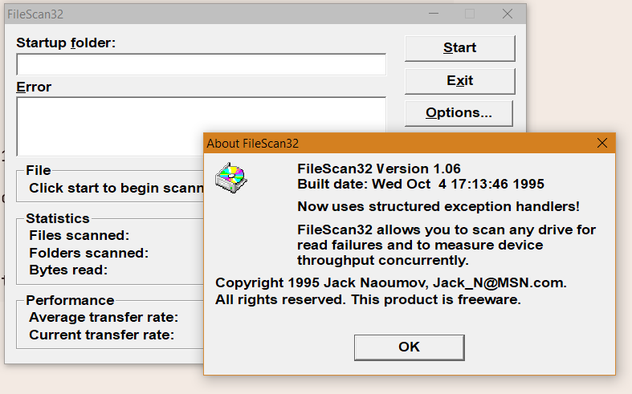
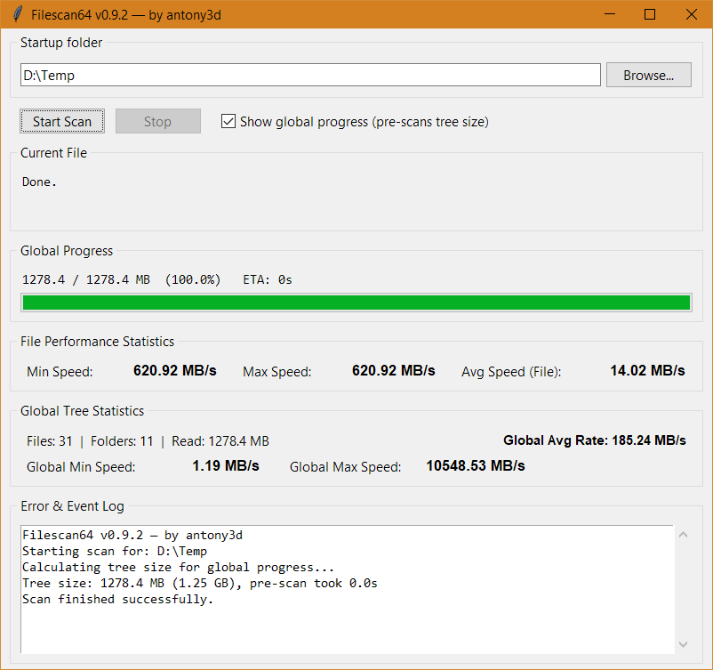

[🇬🇧 English](README.md) | 🇷🇺 Русский

# FileScan64 v0.9.2

Современная реплика классического тестера скорости чтения диска на Python/Tkinter. Последовательно читает все файлы в дереве каталогов и показывает скорость чтения по файлу и общую.

## Скриншоты

1995:

2026:



### Возможности

- Выбор начальной директории дерева сканирования
- Статистика работы: объём — файлы, папки, прочитано МБ; скорость — avg / min / max (по файлу и общая)
- Опциональный общий прогресс с предрасчётом размера дерева + ETA
- Прогрессбар файла только для файлов > 100 МБ
- Лог ошибок и событий

### Требования и запуск

Python 3 + `tkinter`, без зависимостей. Linux / Windows.

```bash
python3 filescan64.py
```

### Константы

| Константа | Значение | Смысл |
|---|---|---|
| `BUFFER_SIZE` | 256 КБ | чанк чтения |
| `LARGE_FILE_THRESHOLD` | 50 МБ | порог объёма для обновления UI |
| `PROGRESS_FILE_MIN` | 100 МБ | показывать прогресс файла |
| `UI_UPDATE_INTERVAL` | 0.25 с | минимальное обновление UI |

## Основано на

```
FileScan32 Version 1.06
Built date: Wed Oct 4 17:13:46 1995

Copyright 1995 Jack Naoumov, Jack_N@MSN.com.
All rights reserved. This product is freeware.
```

## Лицензия

MIT — см. [LICENSE](LICENSE).
